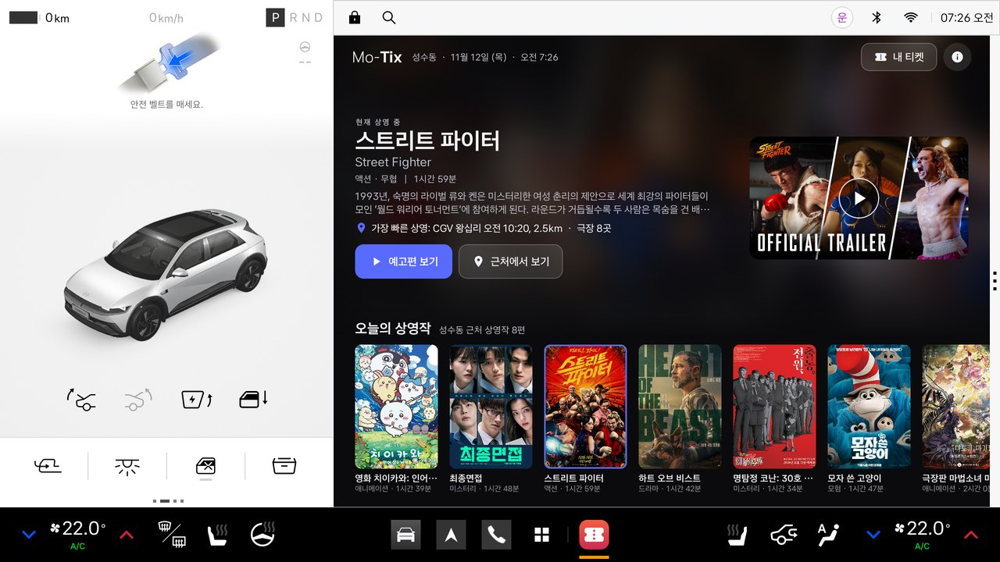
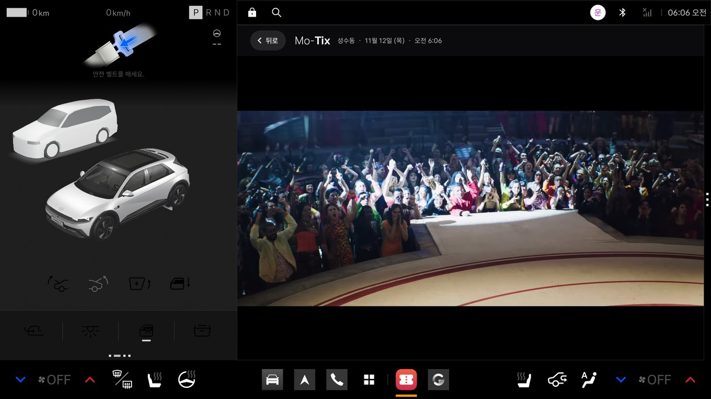
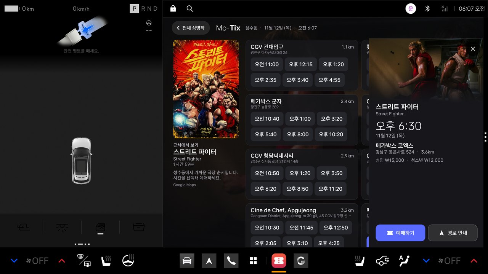
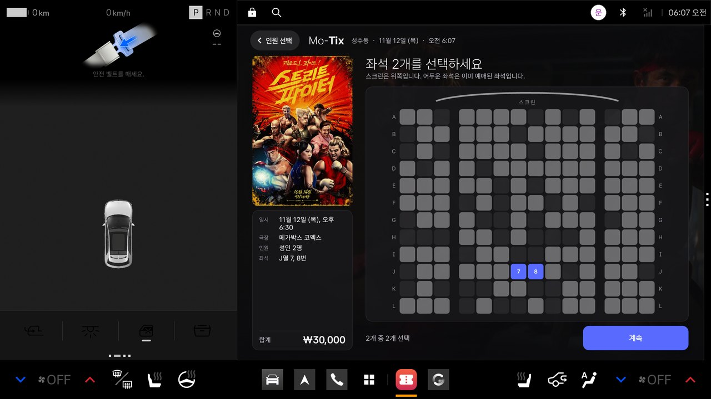
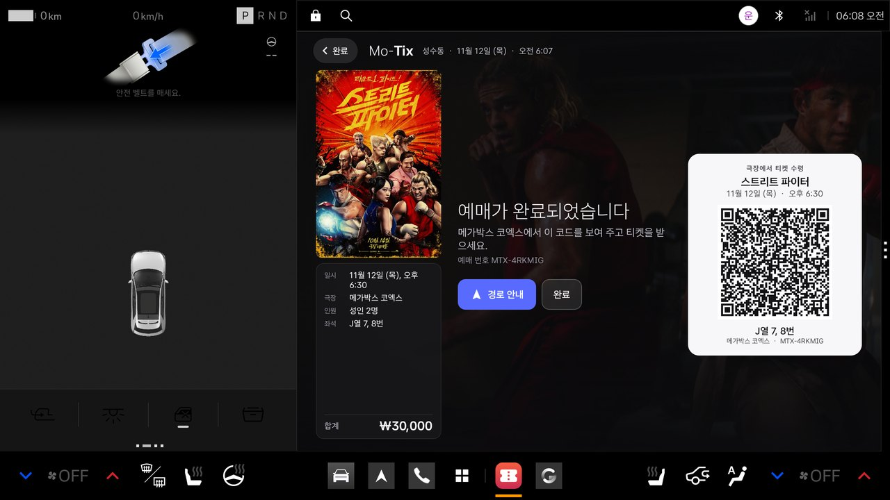
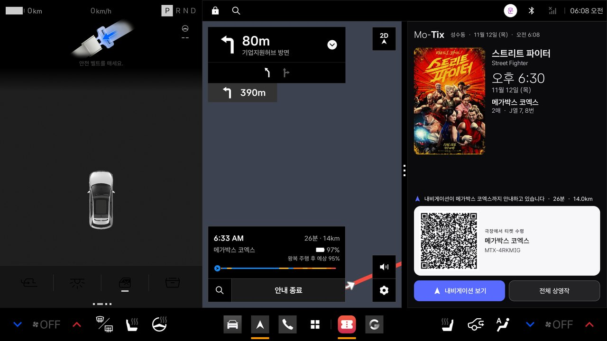
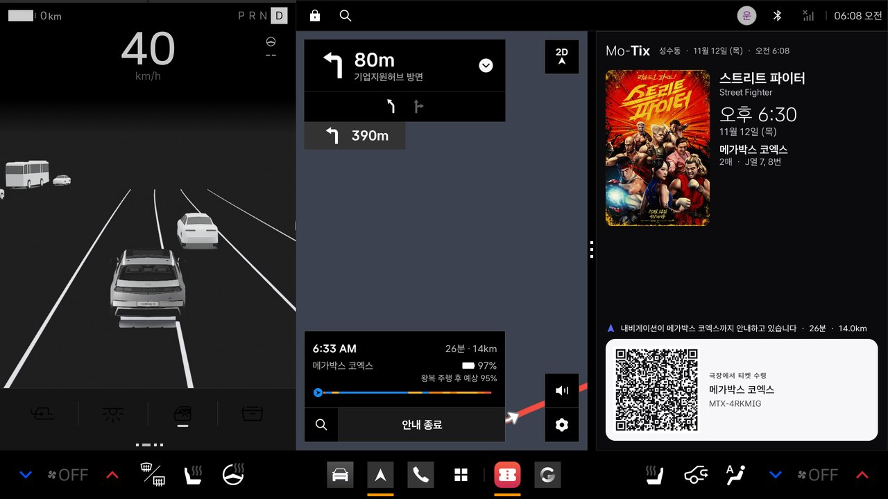

# Mo-Tix

**영화가 있는 곳으로** · [English](README.md)

Mo-Tix는 **Pleos Connect**(Android Automotive OS 14)용 위치 기반 엔터테인먼트 커머스 앱입니다. 차량의 위치와 대화면을
활용해 지금 가까운 극장에서 상영 중인 영화를 보여 주고, 주차 중에는 공식 예고편을 재생하며, 좌석을 예매하고, 한 번의
터치로 극장을 차량 내비게이션의 목적지로 보냅니다. 주행 중에는 정적인 티켓 카드만 표시합니다.

Kotlin과 Jetpack Compose로 만든 네이티브 앱입니다. 별도의 서버나 PC 서비스 없이 헤드 유닛이 데이터 제공처와 직접
통신하며, 차량과는 Pleos Connect SDK와 표준 AAOS Car API로 연동합니다.

> **예매는 시뮬레이션입니다.** Mo-Tix의 데이터 출처에는 상영 시간표 서비스가 없고, 아직 예매 파트너가 연동되어 있지
> 않습니다. 상영 시간은 대표 시간표이고 좌석 배치는 생성된 것이며, **실제 결제는 이루어지지 않고 티켓도 발급되지
> 않습니다.** 화면은 완성된 제품과 같은 흐름으로 동작합니다. 자세한 내용은 [예매 시뮬레이션](#예매-시뮬레이션)을 참고하세요.



| 예고편(주차 중) | 극장과 상영 시간 | 좌석 선택 |
|---|---|---|
|  |  |  |

| 예매 완료와 수령 QR | 차량 내비게이션 경로 안내 | 주행 중: 정적인 티켓 카드 |
|---|---|---|
|  |  |  |

한국어와 영어 전체 화면은 [docs/SCREENS.md](docs/SCREENS.md)에 있습니다. 모든 화면은 42dot의 공식 Pleos Connect
에뮬레이터(v2.1.0)에서 캡처했습니다.

## 주요 기능

1. **위치 기반 상영작.** 차량 위치를 기준으로 현재 상영 중인 영화를 포스터와 스틸, 한국어·영어 제목과 함께 보여
   줍니다. 한국에서는 가까운 CGV·메가박스·롯데시네마 지점을, 미국에서는 가까운 영화관을 거리와 함께 표시합니다.
2. **대화면 예고편.** 공식 예고편을 YouTube 플레이어로 전체 창에서 사운드와 함께 재생합니다. **주차 중에만** 가능하며,
   차량이 P단을 벗어나는 순간 플레이어가 종료되고 스스로 다시 재생되지 않습니다.
3. **차 안에서 예매.** 극장과 시간, 인원과 좌석을 고르고 등록된 카드로 결제합니다. **주차 중에만** 가능합니다.
   (시뮬레이션입니다. 아래 참고)
4. **수령 QR.** 예매가 끝나면 QR 코드와 예매 번호가 담긴 티켓 카드가 표시됩니다.
5. **원탭 경로 안내.** '경로 안내'를 누르면 극장이 Pleos 내비게이션의 목적지로 전달되고 내비게이션이 앞으로
   나옵니다. 지도 옆 분할 창(1:1)에서는 Mo-Tix가 포스터·시간·좌석·QR이 담긴 티켓 카드로 표시됩니다.
6. **주행을 고려한 설계.** 정차·주행 중에는 정적인 티켓 카드만(티켓이 없으면 안내 문구만) 표시합니다. 영상도,
   결제도, 움직이는 요소도 없습니다.

## Pleos Connect 연동

| 기능 | 사용한 것 | 위치 |
|---|---|---|
| 극장까지 경로 안내 | **Pleos NaviHelper SDK**(`ai.pleos.playground:NaviHelper:3.0.5`): `requestRoute` 후 `requestNavigationScreen(Foreground)`. 소요 시간과 거리는 `onRouteStarted` / `onDestinationInfo`로 받습니다. Mo-Tix는 지도를 그리거나 경로를 계산하지 않습니다. | [`platform/CarNavigator.kt`](app/src/main/java/com/hyperscopic/motix/platform/CarNavigator.kt) |
| 차량 위치 | **Pleos FusedLocation SDK**(`ai.pleos.playground:FusedLocation:1.1.3`). 서비스가 지원되지 않거나 응답이 없으면 Android `LocationManager`를 사용합니다. | [`platform/CarLocation.kt`](app/src/main/java/com/hyperscopic/motix/platform/CarLocation.kt) |
| 주행 제한 | Pleos 정책("표준 우선")에 따라 표준 AAOS Car API를 사용합니다. `CarUxRestrictionsManager`(`isRequiresDistractionOptimization`, `UX_RESTRICTIONS_NO_VIDEO`)를 기준으로 하고, `CarPropertyManager`의 기어(`GEAR_SELECTION`)는 제한을 더 엄격하게만 만듭니다. 액티비티는 `distractionOptimized`를 선언하고 스스로 제한을 적용합니다. | [`platform/DrivingMonitor.kt`](app/src/main/java/com/hyperscopic/motix/platform/DrivingMonitor.kt) |
| 윈도우 정책 | 크기 조절이 가능한 하나의 액티비티가 전체 앱 영역(2:0, 약 1682 × 1210 dp)과 분할 창(1:1, 약 841 × 1210 dp) 모두에 맞게 배치됩니다. | [`ui/MoTixRoot.kt`](app/src/main/java/com/hyperscopic/motix/ui/MoTixRoot.kt) |
| 디자인 가이드 | Asta Sans 서체, 가이드의 타이포그래피 스케일과 기본 색(#596BFF), 큰 터치 영역, 주행 중 정적 콘텐츠만 표시 | [`ui/Theme.kt`](app/src/main/java/com/hyperscopic/motix/ui/Theme.kt) |
| 언어 | 한국어·영어(`values-ko`, `values`). 차량 언어 설정을 따릅니다. | [`res/`](app/src/main/res) |

구성 요소의 관계, 로딩·캐시 규칙, 주행 로직은 [docs/ARCHITECTURE.md](docs/ARCHITECTURE.md)(영문)에 정리했습니다.

## 데이터 출처

| 항목 | 출처 |
|---|---|
| 현재 상영작 | Google Gemini 2.5 Flash의 **Google 검색 그라운딩** |
| 극장 | **Google Places API (New)**: 한국에서는 CGV·메가박스·롯데시네마 텍스트 검색, 미국에서는 주변 검색 |
| 포스터, 스틸, 줄거리, 러닝타임, 공식 예고편 ID | **TMDB API** |
| 예고편 | **YouTube 임베디드 플레이어**의 공식 예고편(YouTube oEmbed로 확인) |
| 경로와 길 안내 | 차량 내비게이션(Pleos NaviHelper) |

출처 표기와 라이선스는 [NOTICE.md](NOTICE.md)를 참고하세요. *This product uses the TMDB API but is not endorsed or
certified by TMDB.* (이 제품은 TMDB API를 사용하지만 TMDB의 보증이나 인증을 받지 않았습니다.)

## 예매 시뮬레이션

상영 시간 선택부터 QR 코드까지는 모두 하나의 인터페이스,
[`TicketingPartner`](app/src/main/java/com/hyperscopic/motix/data/Ticketing.kt) 뒤에 있습니다. 현재 구현은
`SimulatedTicketingPartner` 하나입니다.

- **상영 시간**은 영화와 극장별 대표 시간표입니다(항상 같은 결과가 나오며 러닝타임 간격으로 배치됩니다). 실제 극장의
  상영 시간이 아닙니다.
- **좌석**은 생성된 좌석 배치이며 실제로 선점되지 않습니다.
- **결제**는 약 1초가 걸리지만 아무것도 청구하지 않습니다. '등록된 카드 ···· 4821'은 실제 카드가 아닙니다.
- **QR 코드**는 티켓이 아닙니다. 휴대폰으로 스캔하면 해당 극장의 해당 영화 실제 상영 시간표 검색 결과가 열립니다
  (한국은 네이버, 그 외는 Google).

멀티플렉스나 예매 대행사 API를 연동할 때는 같은 인터페이스를 구현해(실시간 상영 정보, 좌석 선점, 결제, 티켓 발급)
시뮬레이션을 교체하면 되며, 화면은 바뀌지 않습니다. 앱 화면에는 시뮬레이션이라는 표시가 없습니다.

## 빌드

필요 환경: JDK 17, Android SDK Platform 34. Pleos SDK는 42dot의 공개 Maven 저장소
(`https://nexus-playground.pleos.ai/repository/maven-releases/`)에서 받으며, 이미 설정되어 있습니다.

```bash
cp local.properties.example local.properties   # sdk.dir과 키를 채웁니다
./gradlew assembleDebug                         # app/build/outputs/apk/debug/app-debug.apk
./gradlew assembleRelease                       # local.properties에 MOTIX_KEYSTORE가 있으면 서명됩니다
```

### 키

키는 `local.properties`(git에서 제외)에 둡니다. [`local.properties.example`](local.properties.example)을 참고하세요.

| 키 | 용도 | 제한 권장 |
|---|---|---|
| `GEMINI_API_KEY` (Vertex AI express 키는 `GEMINI_VERTEX_PROJECT`도 설정) | 상영작 검색 | Gemini / Vertex AI API만 허용 |
| `GOOGLE_API_KEY` | Places API (New) | Places API (New)만 허용, Android 앱 제한(패키지 `com.hyperscopic.motix` + 서명 인증서 SHA-1) |
| `TMDB_API_KEY` 또는 `TMDB_READ_TOKEN` | 포스터, 스틸, 예고편 | (TMDB 키는 제한할 수 없습니다) |

**키는 APK 안에 포함되며 추출될 수 있습니다.** 사용 범위와 할당량을 제한한 키로 만든 시연용 빌드에는 괜찮지만 운영
환경에는 적합하지 않습니다. `ListingsRepository`가 교체 지점입니다. 서버에서 키를 관리하는 구현으로 바꾸면 앱에는
키가 들어가지 않습니다.

키가 없어도 앱은 빌드되고 실행되며, 키가 없다는 안내를 표시합니다.

## Pleos Connect 에뮬레이터에서 실행

1. 42dot의 Pleos Connect 에뮬레이터를 설치하고 AVD를 만듭니다
   ([설치 가이드](https://document.pleos.ai/docs/connect/guide/getting-started/application-development/setup-connect-sdk-emulator)).
   **반드시 콜드 부팅**하세요. 퀵 부트 스냅샷으로 시작하면 차량 HAL이 동작하지 않습니다.
2. 앱을 설치하고 차량 위치를 지정합니다.
   ```bash
   adb -s <serial> install -r app/build/outputs/apk/debug/app-debug.apk
   adb -s <serial> emu geo fix 127.0557 37.5446      # 경도가 먼저입니다: 서울 성수동
   ```
3. Pleos 앱 목록에서 **Mo-Tix**를 엽니다. 처음 실행하면 차량 위치가 필요한 이유를 안내한 뒤, Pleos가 권한을 두 번
   묻습니다(Android 위치, Pleos 융합 위치).
4. **주행 상태**는 에뮬레이터가 제공하는 *Pleos Connect Virtual Console*(기어, 속도)로 바꿉니다. 터미널에서는 다음과
   같이 할 수 있습니다.
   ```bash
   adb -s <serial> forward tcp:18088 tcp:8088
   curl -X PUT "http://127.0.0.1:18088/vehicle/gear?gear=Drive"
   curl -X PUT "http://127.0.0.1:18088/vehicle/controls?speed=30&accelerator=20&brake=0"
   curl -X PUT "http://127.0.0.1:18088/vehicle/controls?speed=0&accelerator=0&brake=60"
   curl -X PUT "http://127.0.0.1:18088/vehicle/gear?gear=Park"
   ```
5. **분할 창**: 창 가장자리의 핸들(점 세 개)을 밀면 Mo-Tix가 내비게이션 옆에 배치됩니다.

언어는 차량 설정을 따릅니다(차량 설정 › 일반 › 언어).

## 프로젝트 구조

```
app/src/main/java/com/hyperscopic/motix/
  MainActivity.kt, MoTixApp.kt, MoTixViewModel.kt   상태, 화면 스택, 로딩 규칙
  platform/   CarNavigator (NaviHelper) · CarLocation (FusedLocation) · DrivingMonitor (CarUxRestrictions, 기어)
  data/       ListingsRepository + GoogleListings (Gemini, Places, TMDB, YouTube) · LineupStore · Images
              Ticketing (TicketingPartner, SimulatedTicketingPartner) · QrCode
  ui/         MoTixRoot · Lineup · Trailer · Theaters · Buy · Ticket · Theme (Pleos 타이포그래피 스케일)
docs/         ARCHITECTURE.md · SCREENS.md · screenshots/
```

## 알려진 제한 사항

- 상영 시간, 좌석, 결제, 티켓은 시뮬레이션입니다(위 참고).
- 예고편은 YouTube 기본 임베디드 플레이어로 재생되며, YouTube가 예고편 앞에 광고를 표시할 수 있습니다.
- 상영작 목록에 붙는 Google 검색 제안 표시는 이 빌드에서 꺼 두었습니다(`ui/TrailerScreen.kt`의
  `SHOW_SEARCH_SUGGESTIONS`). Google 검색 그라운딩 약관은 그라운딩 결과와 함께 검색 제안을 표시하도록 요구하므로,
  공개 배포 전에는 이 옵션을 켜거나 상영작 목록의 출처를 바꿔야 합니다.
- 상영작 목록은 그날 Google 검색 그라운딩이 돌려준 결과입니다. 첫 검색에는 15~20초 정도 걸리며, 이후에는 마지막
  목록을 바로 보여 주고 뒤에서 새로 고칩니다.
- 에뮬레이터의 내비게이션 앱은 자체 가상 위치를 사용하므로 경로가 `geo fix` 위치가 아닌 그 위치에서 시작합니다.
  실제 차량에서는 둘 다 차량의 위치를 사용합니다.
- 아직 연동하지 않은 것: 예고편용 미디어 세션, 음성(Gleo AI / SpeechToText).

## 크레딧

Mo-Tix by Hyperscopic. 영화 이미지와 예고편의 권리는 각 권리자에게 있습니다. [NOTICE.md](NOTICE.md)를 참고하세요.
