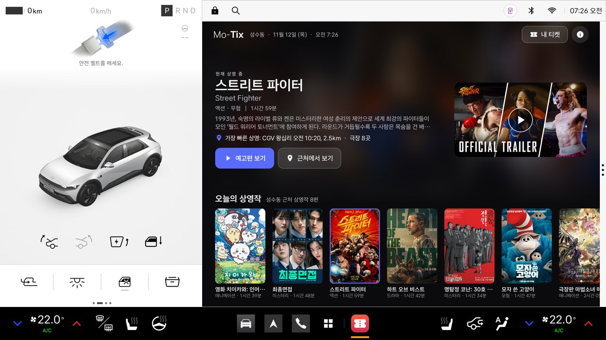
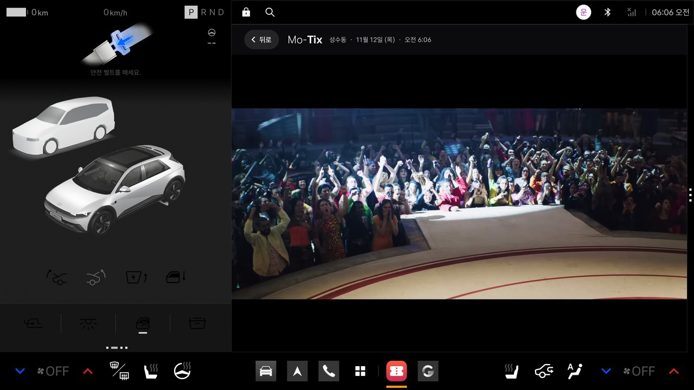
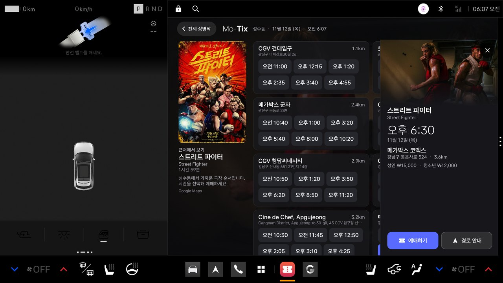
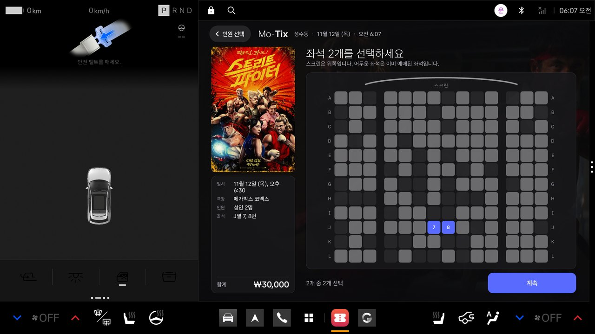
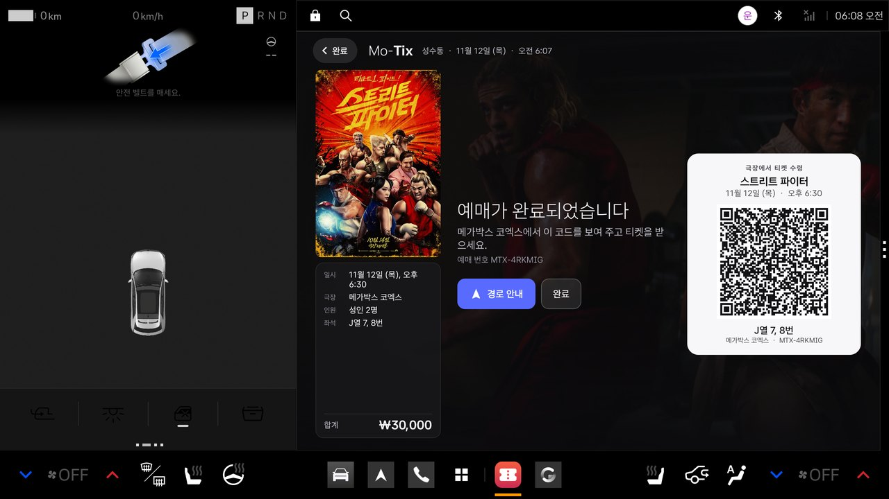
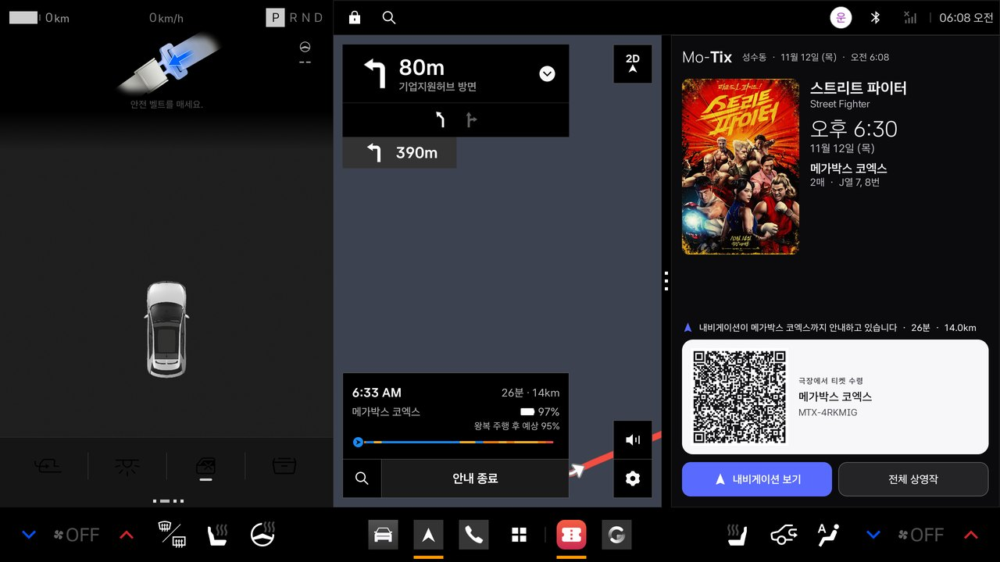
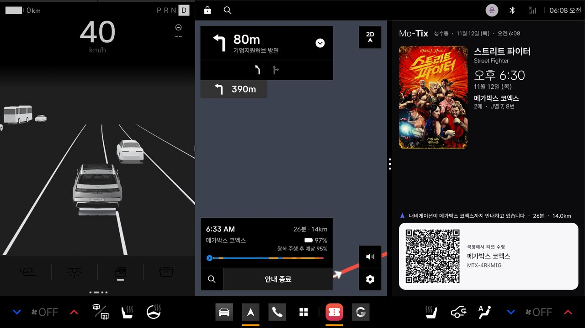

# Mo-Tix

**Be where the movies are.** · [한국어](README.ko.md)

Mo-Tix is a location-aware entertainment commerce app for **Pleos Connect** (Android Automotive OS 14). It uses the
car's position and the big screen to show what is playing at the theaters nearby, plays the official trailer while the
car is parked, books seats, and hands the theater to the car's own navigation in one tap. While the car is moving it
shows only a static ticket card.

It is a native Kotlin / Jetpack Compose app. There is no companion server and no PC service: the head unit talks to the
data providers directly, and to the car through the Pleos Connect SDK and the standard AAOS Car API.

> **Ticketing is simulated.** Mo-Tix's data sources have no showtimes service, and no ticketing partner is connected
> yet. Showtimes are a representative schedule, the seat map is generated, **no payment is taken and no ticket is
> issued**. The screens run the purchase as the finished product would. See [Simulated ticketing](#simulated-ticketing).

> **It runs without any API key.** Out of the box Mo-Tix is in *cached mode*: it shows a Seoul lineup saved with the
> app (Seongsu-dong, captured 2026-11-12: 8 films, 8 theaters), so the whole flow works on a fresh build. The
> **Saved / Live** switch on the lineup turns on live listings for wherever the car is, once the build has your own
> keys. See [Cached mode](#cached-mode).



| Trailer, parked | Theaters and showtimes | Seats |
|---|---|---|
|  |  |  |

| Booked, with the collection QR | Route in the native navigation | Driving: the static ticket card |
|---|---|---|
|  |  |  |

More screens, in Korean and English: [docs/SCREENS.md](docs/SCREENS.md). All of them were captured on 42dot's official
Pleos Connect emulator (v2.1.0).

## What it does

1. **Location-aware lineup.** The films in theaters now where the car is, with posters, stills and both Korean and
   English titles; the nearest CGV, Megabox and Lotte Cinema branches in Korea (movie theaters in the US), with distances.
2. **Big-screen trailers.** The official trailer in the YouTube player, full window with sound, **only while parked**.
   The moment the car leaves Park the player is destroyed; it does not resume by itself.
3. **Booking in the car.** Pick a theater and a time, the number of tickets and the seats, and pay with the saved card,
   **only while parked**. (Simulated, see below.)
4. **Collection QR.** A booked showing gives a QR code and a booking reference on a ticket card.
5. **One-tap route.** "Get route" sends the theater to the Pleos navigation and brings the navigation forward. In the
   half window (1:1) beside the map, Mo-Tix is the ticket card: poster, time, seats, QR.
6. **Designed for driving.** While the car is idling or moving, Mo-Tix shows only the static ticket card (or, with no
   ticket, a plain notice). No video, no payment, nothing that moves.

## Pleos Connect integration

| Need | What Mo-Tix uses | Where |
|---|---|---|
| Route to the theater | **Pleos NaviHelper SDK** (`ai.pleos.playground:NaviHelper:3.0.5`): `requestRoute`, then `requestNavigationScreen(Foreground)`; time and distance from `onRouteStarted` / `onDestinationInfo`. Mo-Tix draws no map and computes no route. | [`platform/CarNavigator.kt`](app/src/main/java/com/hyperscopic/motix/platform/CarNavigator.kt) |
| The car's position | **Pleos FusedLocation SDK** (`ai.pleos.playground:FusedLocation:1.1.3`), with Android `LocationManager` as the fallback when the service is not supported or stays silent. | [`platform/CarLocation.kt`](app/src/main/java/com/hyperscopic/motix/platform/CarLocation.kt) |
| Driving restrictions | The standard AAOS Car API, as Pleos asks ("standard first"): `CarUxRestrictionsManager` is the authority (`isRequiresDistractionOptimization`, `UX_RESTRICTIONS_NO_VIDEO`); the gear from `CarPropertyManager` (`GEAR_SELECTION`) only makes it stricter. The activity declares `distractionOptimized` and restricts itself. | [`platform/DrivingMonitor.kt`](app/src/main/java/com/hyperscopic/motix/platform/DrivingMonitor.kt) |
| Window policy | One resizable activity that lays out for the full app area (2:0, about 1682 × 1210 dp) and the half window (1:1, about 841 × 1210 dp). | [`ui/MoTixRoot.kt`](app/src/main/java/com/hyperscopic/motix/ui/MoTixRoot.kt) |
| Design guide | Asta Sans, the guide's type scale and primary colour (#596BFF), large touch targets; static content only while driving. | [`ui/Theme.kt`](app/src/main/java/com/hyperscopic/motix/ui/Theme.kt) |
| Languages | Korean and English (`values-ko`, `values`), following the car's language. | [`res/`](app/src/main/res) |

How the pieces fit, the loading and caching rules, and the driving logic: [docs/ARCHITECTURE.md](docs/ARCHITECTURE.md).

## Data sources

| What | Source |
|---|---|
| Films in theaters now | Google Gemini 2.5 Flash with **Grounding with Google Search** |
| Theaters | **Google Places API (New)**: a text search for CGV, Megabox and Lotte Cinema in Korea, a nearby search in the US |
| Posters, stills, synopses, running times, official trailer ids | **TMDB API** |
| Trailers | The official trailer in the **YouTube embedded player**, confirmed with YouTube oEmbed |
| Routes and guidance | The car's navigation (Pleos NaviHelper) |

Attribution and licences: [NOTICE.md](NOTICE.md). *This product uses the TMDB API but is not endorsed or certified by TMDB.*

## Simulated ticketing

Everything from the showtime chips to the QR code sits behind one interface,
[`TicketingPartner`](app/src/main/java/com/hyperscopic/motix/data/Ticketing.kt). The only implementation today is
`SimulatedTicketingPartner`:

- **Showtimes** are a representative daily schedule per film and theater (deterministic, spaced by the film's running
  time). They are not the theater's real showtimes.
- **Seats** are a generated seat map. Nothing is held.
- **Payment** takes about a second and charges nothing. "Saved card ···· 4821" is not a real card.
- **The QR code** is not a ticket. It opens that theater's real showtimes for that film on a phone (Naver in Korea,
  Google elsewhere).

A multiplex or booking-agency integration implements the same interface (real showtimes, seat holds, payment, ticket
delivery) and replaces the simulation; no screen changes. The app's screens do not label this as a simulation.

## Cached mode

`cachedMode` is on by default. In it, the films, artwork addresses, trailer ids and theaters come from
[`app/src/main/assets/snapshot/seoul.json`](app/src/main/assets/snapshot/seoul.json), a snapshot of what the live
sources returned for Seongsu-dong, Seoul, on 2026-11-12. The lineup says so ("as of Thu, Nov 12").

- **No keys and no location permission are needed.** The car is treated as being where the snapshot was captured.
- Everything after the listings is the same as live: showtimes are made for today, posters and trailers stream from
  TMDB and YouTube (so a network connection is still needed), and Get route goes to the real Pleos navigation.
- The **Saved / Live** switch on the lineup changes mode. Live needs keys in the build (below) and the car's position;
  a build without keys says so and stays on the saved listings.
- To refresh the snapshot, see [docs/ARCHITECTURE.md](docs/ARCHITECTURE.md#cached-mode-and-the-snapshot).

## Build

Requirements: JDK 17, Android SDK Platform 34. The Pleos SDKs come from 42dot's public Maven repository
(`https://nexus-playground.pleos.ai/repository/maven-releases/`), already configured.

```bash
cp local.properties.example local.properties   # then fill in sdk.dir and the keys
./gradlew assembleDebug                         # app/build/outputs/apk/debug/app-debug.apk
./gradlew assembleRelease                       # signed when MOTIX_KEYSTORE is set in local.properties
./gradlew assembleRelease -PnoKeys              # the same, with no API keys in the APK (cached mode only)
```

Keys are optional: with none, the app runs in cached mode.

### Keys

`local.properties` (git-ignored) holds the keys; see [`local.properties.example`](local.properties.example).

| Key | For | Restrict it to |
|---|---|---|
| `GEMINI_API_KEY` (+ `GEMINI_VERTEX_PROJECT` for a Vertex AI express key) | the film search | the Gemini / Vertex AI API only |
| `GOOGLE_API_KEY` | Places API (New) | the Places API (New), and this Android app (package `com.hyperscopic.motix` + your signing certificate SHA-1) |
| `TMDB_API_KEY` or `TMDB_READ_TOKEN` | posters, stills, trailers | (TMDB keys cannot be restricted) |

The keys are read at build time and compiled into the APK you build.

## Run it on the Pleos Connect emulator

1. Install 42dot's Pleos Connect emulator and create its AVD
   ([setup guide](https://document.pleos.ai/en/docs/connect/guide/getting-started/application-development/setup-connect-sdk-emulator)).
   **Cold boot it**: a quick-boot snapshot disables the vehicle HAL.
2. Install and place the car:
   ```bash
   adb -s <serial> install -r app/build/outputs/apk/debug/app-debug.apk
   adb -s <serial> emu geo fix 127.0557 37.5446      # longitude first: Seongsu-dong, Seoul
   ```
3. Open **Mo-Tix** from the Pleos app library. It opens on the saved Seoul lineup. Switch to **Live** (a build with
   keys) and it explains why it wants the car's position, then Pleos asks twice (Android location, and the Pleos
   fused position).
4. **Driving states**: use the *Pleos Connect Virtual Console* that the emulator serves (gear, speed). From a terminal:
   ```bash
   adb -s <serial> forward tcp:18088 tcp:8088
   curl -X PUT "http://127.0.0.1:18088/vehicle/gear?gear=Drive"
   curl -X PUT "http://127.0.0.1:18088/vehicle/controls?speed=30&accelerator=20&brake=0"
   curl -X PUT "http://127.0.0.1:18088/vehicle/controls?speed=0&accelerator=0&brake=60"
   curl -X PUT "http://127.0.0.1:18088/vehicle/gear?gear=Park"
   ```
5. **Half window**: swipe the window handle (the three dots on the window's edge) to put Mo-Tix beside the navigation.

Language follows the car: Vehicle Settings › General › Language.

## Project layout

```
app/src/main/java/com/hyperscopic/motix/
  MainActivity.kt, MoTixApp.kt, MoTixViewModel.kt   state, screen stack, the loading rule
  platform/   CarNavigator (NaviHelper) · CarLocation (FusedLocation) · DrivingMonitor (CarUxRestrictions, gear)
  data/       ListingsRepository + GoogleListings (Gemini, Places, TMDB, YouTube) · LineupStore · Images
              Ticketing (TicketingPartner, SimulatedTicketingPartner) · QrCode
  ui/         MoTixRoot · Lineup · Trailer · Theaters · Buy · Ticket · Theme (Pleos type scale)
docs/         ARCHITECTURE.md · SCREENS.md · screenshots/
```

## Known limits

- Showtimes, seats, payment and tickets are simulated (above).
- The saved listings are a dated sample (2026-11-12); the films in it will go out of date.
- The trailer is the stock YouTube embedded player; YouTube may show an ad before a trailer.
- Google's Search suggestions strip for the grounded film list is switched off in this build
  (`SHOW_SEARCH_SUGGESTIONS` in `ui/TrailerScreen.kt`). Google's terms for Grounding with Google Search ask for it to
  be displayed with grounded results: switch it on, or take the film list from another source, before a public release.
- The film list is whatever Google Search grounding returns that day; a first search takes about 15 to 20 seconds
  (later launches show the last list at once and refresh behind it).
- On the emulator the navigation app keeps its own simulated position, so its route starts from there, not from
  `geo fix`; in a car both come from the vehicle.
- Not yet integrated: a media session for the trailer, voice (Gleo AI / SpeechToText).

## Credits

Mo-Tix by Hyperscopic. Film artwork and trailers belong to their rights holders. See [NOTICE.md](NOTICE.md).
